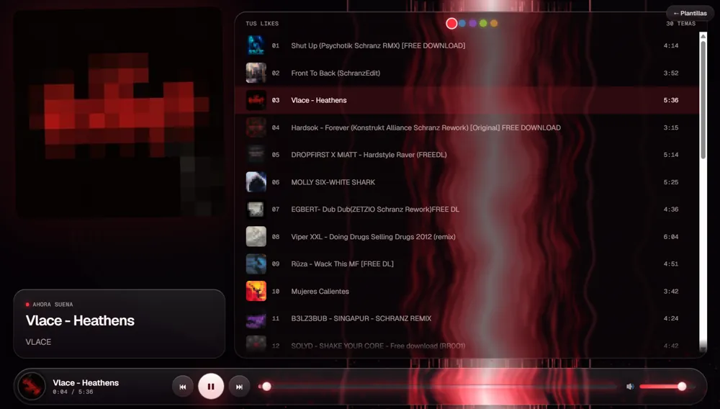
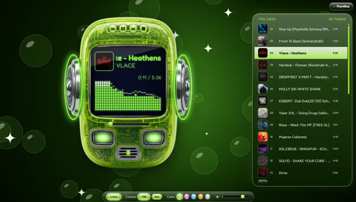
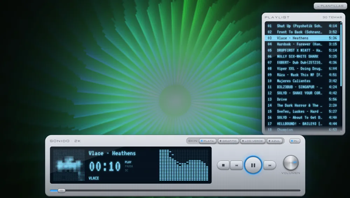
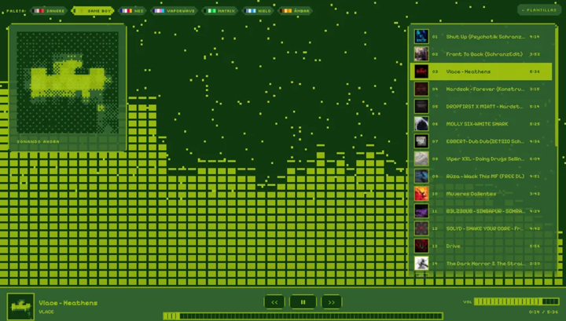

# Reproductor visual

> Nombre provisional. Un reproductor de música para Windows que pone **pantallas que reaccionan al sonido**, con plantillas que puedes **personalizar, crear y compartir**.

Escuchas lo de siempre (Spotify, SoundCloud, tus carpetas, o cualquier cosa que suene en el PC) y la app lo muestra con la pantalla que elijas: un haz de luz que late con el bajo, una cabeza Y2K con el reproductor adentro, un equipo de metal con pantalla LCD, píxeles de 8 bits… o la que armes tú.

| | |
|---|---|
|  **Líquido**: vidrio líquido sobre un haz de luz |  **Headspace**: cabeza Y2K con lista que sale del costado |
|  **2000s**: metal, pantalla LCD y visualizaciones estilo Windows Media Player |  **Ambiente**: la carátula manda, en duotono |
|  **Pixel**: 8 bits con paletas (aquí, Game Boy) | |

*(Las carátulas de las capturas están pixeladas a propósito.)*

## Qué puede hacer

**De dónde suena la música**
- **Spotify**: tus *me gusta* y tus playlists. Suena en tu Spotify de escritorio y la app lo controla con la API de Spotify (requiere Premium).
- **SoundCloud**: tus likes completos, dentro de la app, con la forma de onda real de cada tema.
- **Mi música**: tus carpetas del PC; cada subcarpeta es una lista, con carátulas y etiquetas.
- **Otra app**: lo que suene en el PC (navegador, etc.): título, carátula y botones de Windows.

**Plantillas** (5 incluidas, con 31 variantes de color)
Líquido · Headspace · 2000s · Ambiente · Neo Y2K · Dreamcore · Skin Player · Psicodélico · Pixel. Todas tienen lista de temas, ajustes de intensidad y velocidad, y un modo "solo visual" (los controles se esconden tras 3 s sin mover el mouse; la tecla **H** lo activa o desactiva).

**Biblioteca** (estilo Wallpaper Engine)
Cuadrícula de plantillas con **vista previa en vivo**: la plantilla real corriendo con música inventada. Ahí cambias colores, intensidad, velocidad, mostrar u ocultar la lista, y pones tus propias imágenes (fondo; y en Headspace, un **cuerpo propio** con un editor de zonas).

**Editor y plantillas propias**
Cada plantilla se puede hacer de **piezas** que se arrastran y se estiran sobre una vista previa en vivo.
- **Skins de Winamp (Skin Player):** el reproductor dibuja skins clásicos de Winamp 2 (.wsz): ventana, ecualizador y lista. Se importan en la Biblioteca pegando el link de un skin de [skins.webamp.org](https://skins.webamp.org) o eligiendo un archivo .wsz. Los skins son arte de sus autores: quedan **solo en tu PC** (`~/.visualizador/skins`) y nunca se suben ni se reparten con la app. Sin skins se usa uno clásico propio.
- **Editar una de las 5 incluidas:** "Editar esta plantilla" crea tu versión hecha de piezas (Líquido, Headspace, 2000s, Ambiente y Pixel). Cada una trae sus **reglas**: por ejemplo, Headspace exige su cabeza (que ya trae título, botones y barra adentro) y las demás exigen título, botones y barra de avance. Lo que no está bloqueado se puede mover, cambiar o quitar, y una pieza no puede cumplir la misma función que otra.
- **Crear una libre:** parte de una base (en blanco, reproductor central, con lista) y agrega lo que quieras.
- **Personalización:** fondo (haz, túnel, burbujas, luces, estrellas de píxel, carátula desenfocada, degradado, color o imagen), visuales (barras, bloques de píxel, segmentos LCD, onda, círculo, con opción de reflejo e intensidad), estilo de paneles (vidrio, metal, gel, píxel, liso) con deformación del vidrio opcional, acento fijo o tomado de la carátula, y 6 letras. Cada pieza tiene sus opciones: carátula (cuadrada, redondeada, círculo, vinilo que gira; efecto normal, duotono, pixelada o blanco y negro; inclinación), título y artista (tamaño, alineación, mayúsculas, letra y color propios), barra (línea, onda real del tema o segmentos), botones, lista (con o sin carátulas y números) y opacidad.

**Compartir**
Una plantilla propia se exporta como **un solo archivo `.plantilla`** (configuración + imágenes) y se importa en otro equipo. Son solo datos: no lleva código.

## Cómo instalarlo y usarlo

Requisitos: **Windows 10/11** y **Python 3.12**.

```powershell
git clone https://github.com/Noull999/reproductor-visual.git
cd reproductor-visual
pip install -r requirements.txt
python app.py
```

Primeros pasos:
1. Abre **Ajustes** y conecta lo que uses:
   - **SoundCloud**: "Iniciar sesión" abre una ventana con el login de SoundCloud (la app nunca ve tu contraseña).
   - **Spotify**: "Conectar cuenta" abre el navegador para aceptar el acceso.
   - **Mi música**: "Agregar carpeta…".
2. En **Inicio** elige de dónde suena y en la **Biblioteca** elige una plantilla.
3. Para Spotify, ten la app de escritorio abierta.

Tu configuración y tus imágenes quedan en `~/.visualizador/` (fuera del proyecto).

## Cómo funciona

```
app.py              Ventana (pywebview) y la clase Api que llama la página
servidor.py         Servidor local 127.0.0.1 (páginas, música de tus carpetas, imágenes propias)
fuentes/            soundcloud · spotify · musica · pc (controles de Windows + captura del sonido)
plantillas.py       Exportar/importar .plantilla con validación estricta
web/                Todas las pantallas (HTML/CSS/JS sin framework)
  nucleo.js           Reproductor compartido: fuentes, lista, volumen, solo visual, modo demo
  propiedades.js      Propiedades por plantilla (intensidad, velocidad, extras…)
  esquema.js          Qué puede contener una plantilla (única fuente de verdad: motor, editor y validador)
  plantillas-propias.js, libre.html, modulos.js, editor.html   Motor, módulos (cabeza y equipo) y editor de plantillas propias
tools/              Generador de las vistas previas
tests/              Pruebas
```

- **Los visuales** se alimentan del sonido real: de SoundCloud y Mi música sale del propio reproductor; de Spotify y de otras apps sale de la **captura del sonido del PC** (WASAPI loopback, con ganancia automática para que se vea igual a cualquier volumen).
- **Spotify** gasta su cuota solo en lo necesario: cargar listas (se guardan 10 min), tocar un tema, adelantar y volumen. Qué suena, pausa, siguiente y anterior salen de los controles multimedia de Windows.
- **Una plantilla propia es un JSON**; `libre.html` la dibuja. Lo que viene de fuera nunca se ejecuta: se valida campo por campo contra listas permitidas y las imágenes se vuelven a codificar.

## Estado del proyecto

| Área | Estado |
|---|---|
| Fuentes: Spotify, SoundCloud, Mi música, otra app | ✅ Funcionan (Spotify con límites, ver abajo) |
| 5 plantillas con variantes y lista de temas | ✅ |
| Cuentas y carpetas desde la app (Ajustes) | ✅ (sin probar el selector de carpetas a mano) |
| Biblioteca con vista previa en vivo y personalización | ✅ |
| Cuerpo propio de Headspace con editor de zonas | ✅ |
| Editor de plantillas propias (crear, mezclar, skin libre) y las 5 incluidas editables por piezas con sus reglas | ✅ |
| Exportar e importar plantillas | ✅ |
| Visuales con Spotify (captura del sonido) | ⚠️ Funciona con sonido saliendo por el dispositivo por defecto; se vuelve a detectar si cambias de parlantes |
| Nombre definitivo, ícono y ejecutable (.exe) | ⏳ Pendiente |
| Comunidad (catálogo de plantillas de otras personas) | ⏳ Pendiente |
| Versión Mac | ⏳ No planificada aún |

Detalle y decisiones en [PLAN.md](PLAN.md).

## Limitaciones conocidas

- **Solo Windows** por ahora (controles multimedia y captura de sonido).
- **Spotify en modo desarrollo**: la app solo la pueden usar las cuentas que su dueño autorice (hasta 5), exige Premium y tiene una cuota baja de peticiones: si se agota, Spotify pide esperar (la app lo avisa y no insiste). De las playlists, Spotify solo deja leer las **tuyas o colaborativas**. SoundCloud y Mi música no tienen estos límites.
- Spotify no entrega el audio ni su análisis a apps nuevas; por eso los visuales usan la captura del sonido del PC.
- Las plantillas incluidas siguen siendo páginas con su propio código; "Editar esta plantilla" crea una versión equivalente hecha de piezas en el motor de datos (muy parecida, no idéntica pixel a pixel).
- La cabeza de Headspace y el equipo de 2000s son piezas indivisibles: se mueven, se agrandan y cambian de cuerpo, color o skin, pero no se desarman.

## Seguridad y privacidad

- Los tokens y las claves se guardan en tu carpeta de usuario, nunca en el proyecto. El Client ID de Spotify que viene en el código es público por diseño (acceso con PKCE, sin secreto).
- El servidor local solo escucha en `127.0.0.1` y solo entrega audio de las carpetas que elegiste y las imágenes de su propia carpeta; rechaza rutas con `..`.
- Importar una plantilla ajena no ejecuta nada: se rechaza cualquier archivo con contenido inesperado, rutas raras, tamaños abusivos o imágenes falsas (hay pruebas para esos casos).

## Desarrollo

```powershell
pip install -r requirements-dev.txt
python -m pytest -q tests
python tools/capturar_previas.py   # regenera web/img/previas (abre la app y saca capturas)
```

`python app.py --debug` abre las herramientas de desarrollo de la ventana.

## Créditos y licencias de terceros

- Tipografías incluidas (licencia SIL OFL 1.1): Geist, Geist Mono, Pixelify Sans, Silkscreen, VT323, Michroma, Fredoka e Instrument Serif. Sus licencias están en `web/fonts/`.
- [hls.js](https://github.com/video-dev/hls.js) (Apache-2.0) para reproducir el audio de SoundCloud.
- Las imágenes de los cuerpos de Headspace (`web/img/headspace/`) son ilustraciones generadas con IA, de diseño propio.
- Inspirado en las skins de reproductores de los 2000 y en Wallpaper Engine; no usa imágenes, íconos ni diseños de ellos.

## Licencia

[MIT](LICENSE): puedes usar, copiar, modificar y compartir el código. Las tipografías y hls.js conservan sus propias licencias (ver arriba).
