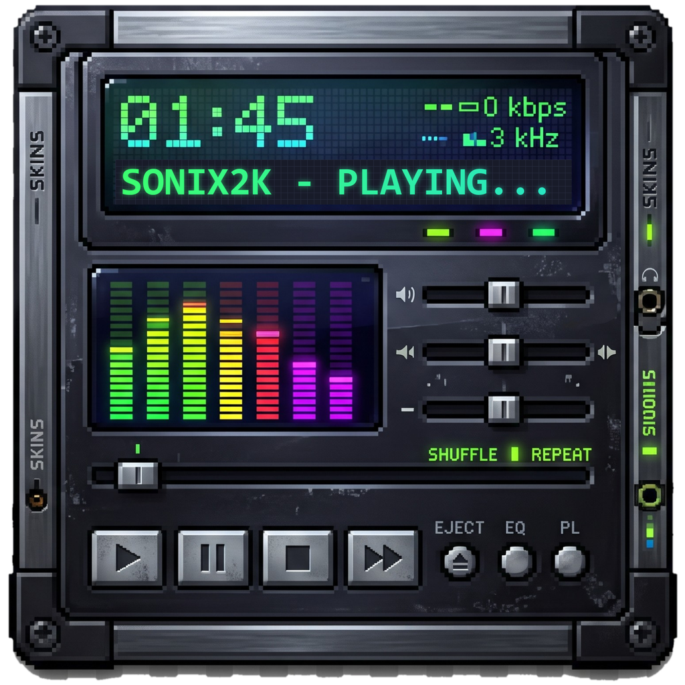

# Sonix2K

> Un reproductor de música para Windows que pone **pantallas que reaccionan al sonido**, con plantillas que puedes **personalizar, crear y compartir**: una especie de Wallpaper Engine para tu música.

Escuchas lo de siempre (Spotify, SoundCloud, tus carpetas, o cualquier cosa que suene en el PC) y la app lo muestra con la pantalla que elijas: un haz de luz que late con el bajo, una cabeza Y2K con el reproductor adentro, un equipo de metal con pantalla LCD, píxeles de 8 bits… o la que armes tú.

<table>
<tr>
<td align="center"><br><b>Líquido</b><br><sub>vidrio líquido sobre un haz que late con el bajo</sub></td>
<td align="center">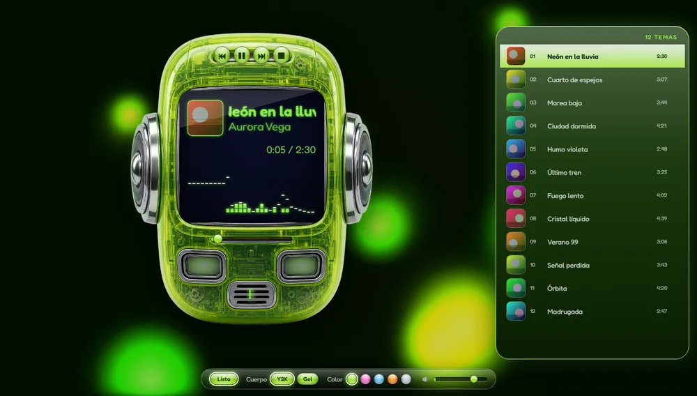<br><b>Headspace</b><br><sub>cabeza Y2K con el reproductor adentro</sub></td>
<td align="center">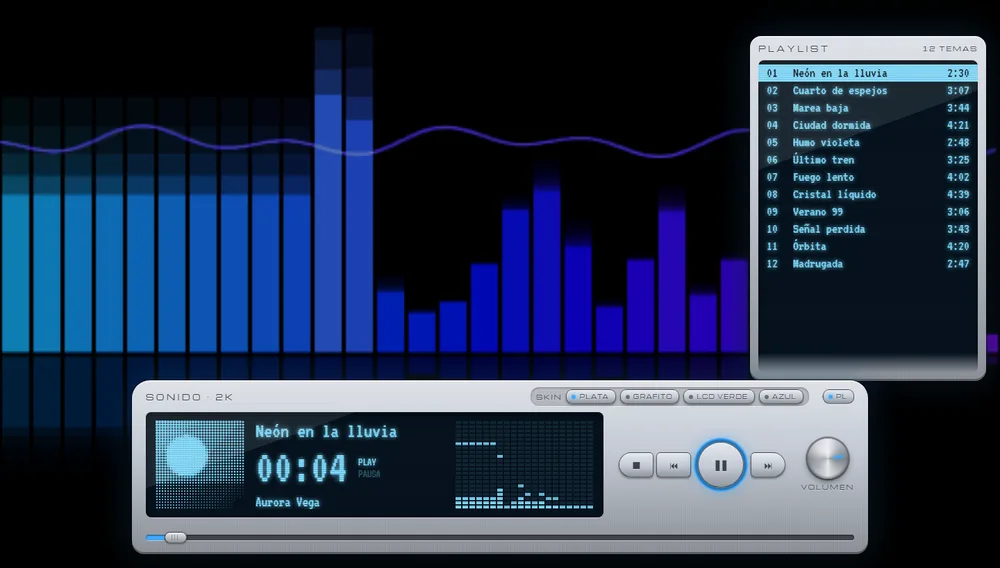<br><b>2000s</b><br><sub>metal, pantalla LCD y visuales tipo Windows Media Player</sub></td>
</tr>
<tr>
<td align="center">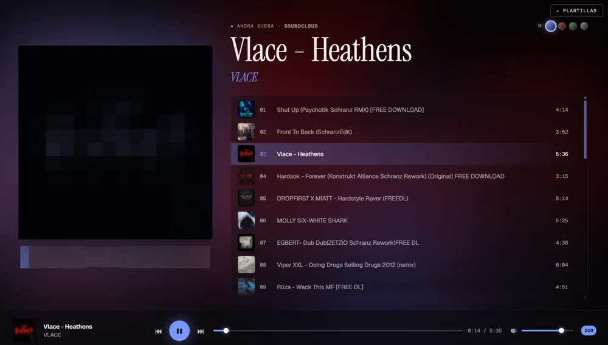<br><b>Ambiente</b><br><sub>la carátula manda, en duotono</sub></td>
<td align="center"><br><b>Pixel</b><br><sub>8 bits con paletas (aquí, Game Boy)</sub></td>
<td align="center">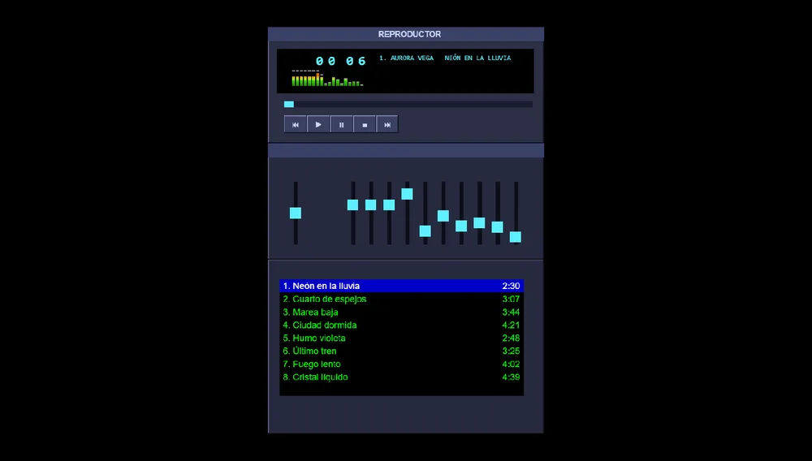<br><b>Winamp</b><br><sub>skins clásicos de Winamp que tú eliges</sub></td>
</tr>
<tr>
<td align="center">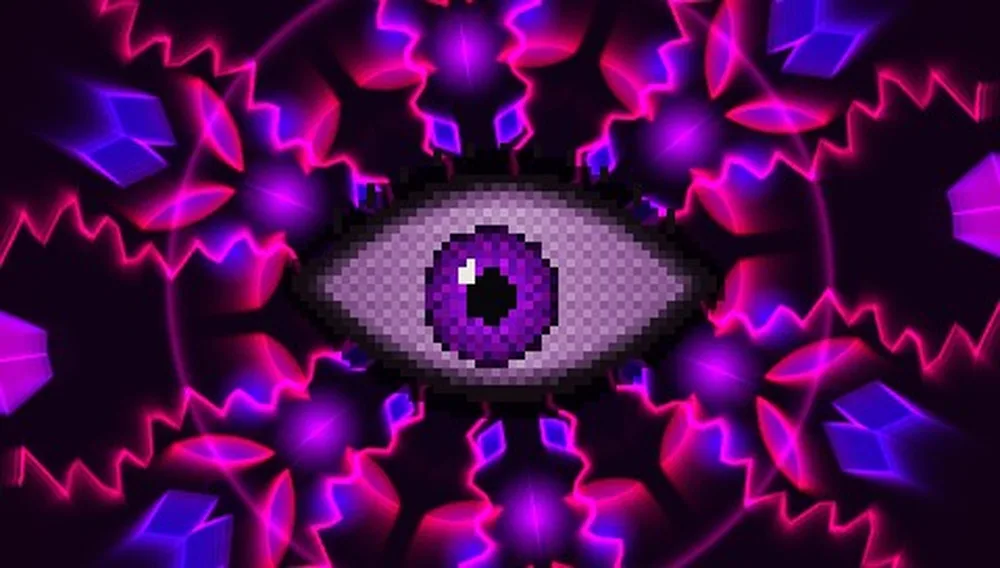<br><b>Psicodélico</b><br><sub>un ojo pixel art sobre un caleidoscopio</sub></td>
<td align="center">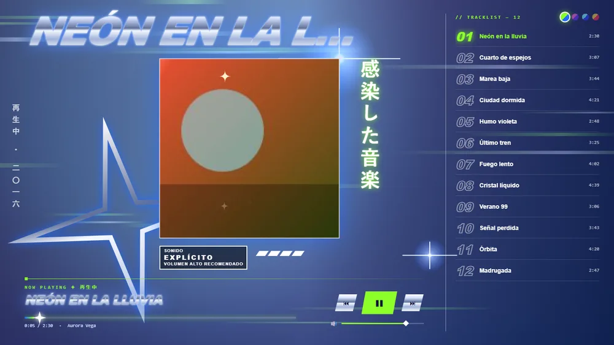<br><b>Neo Y2K</b><br><sub>portada de rap con cromo, destellos y japonés vertical</sub></td>
<td align="center">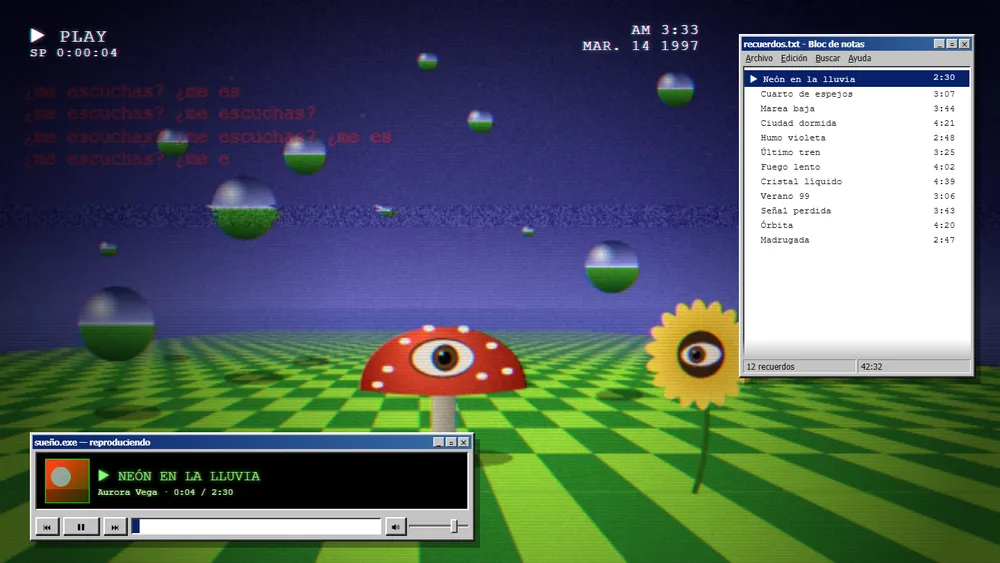<br><b>Dreamcore</b><br><sub>VHS, ventanas de Windows 95 y popups de «virus»</sub></td>
</tr>
<tr>
<td align="center">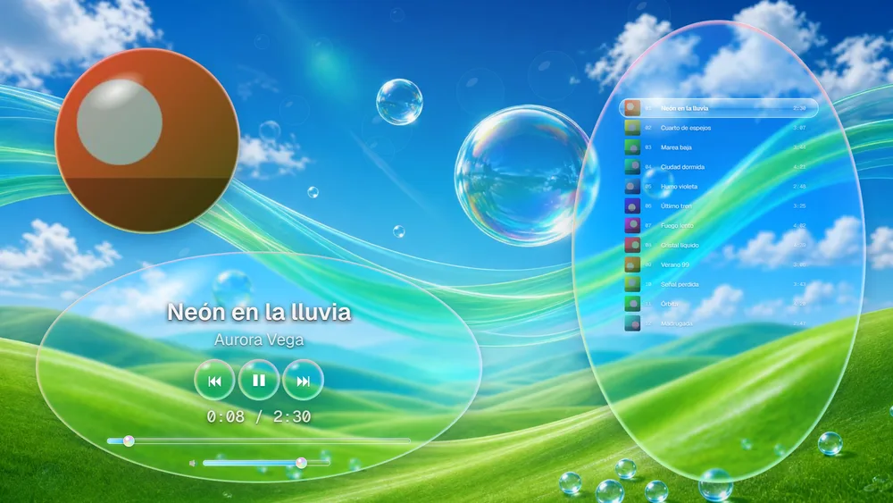<br><b>Frutiger Aero</b><br><sub>colinas o agua de los 2000 y pompas que se revientan</sub></td>
<td align="center">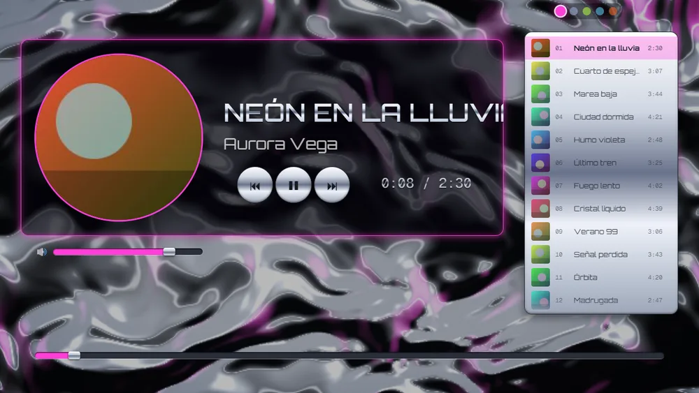<br><b>Cromo líquido</b><br><sub>metal derretido que se sacude con cada bombo</sub></td>
<td align="center">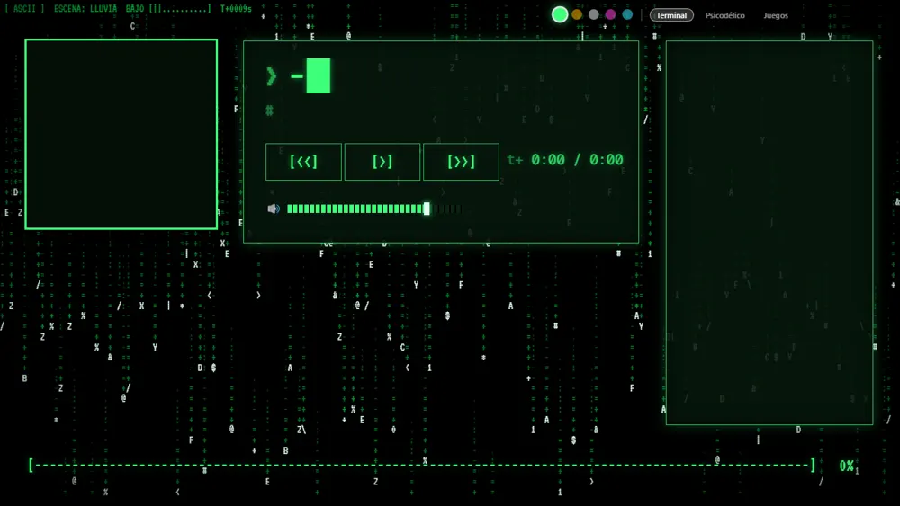<br><b>ASCII</b><br><sub>terminal, psicodélico o arcade, hecho de letras</sub></td>
</tr>
</table>

*(Las carátulas de las capturas son inventadas: así se ven con la música de demostración de la Biblioteca.)*

## Qué puede hacer

**De dónde suena la música**
- **Spotify**: tus *me gusta* y tus playlists. Suena en tu Spotify de escritorio y la app lo controla con la API de Spotify (requiere Premium).
- **SoundCloud**: tus likes completos, dentro de la app, con la forma de onda real de cada tema.
- **Mi música**: tus carpetas del PC; cada subcarpeta es una lista, con carátulas y etiquetas.
- **Otra app**: lo que suene en el PC (navegador, etc.): título, carátula y botones de Windows.
- **Serato DJ** (Lite o Pro): los visuales siguen tu mezcla y se muestra la **última canción cargada** (título, artista y carátula leídos del archivo), sacada del registro que escribe Serato. Si tu audio sale por otra tarjeta (por ejemplo, la de un controlador), elige en el Inicio **qué salida escuchan los visuales**.

**Plantillas** (12 incluidas, con más de 70 variantes de color, tema y escena)
Líquido · Headspace · 2000s · Ambiente · Pixel · Winamp · Psicodélico · Neo Y2K · Dreamcore · Frutiger Aero · Cromo líquido · ASCII. Todas tienen lista de temas, ajustes de intensidad y velocidad, y un modo "solo visual" (los controles se esconden tras 3 s sin mover el mouse; la tecla **H** lo activa o desactiva).
- **Neo Y2K**: 4 variantes, cada una con su figura de cromo y sus partículas (estrella y estelas, corazón y mariposas, carátula que se congela, corona de púas y brasas).
- **Dreamcore**: escenas Damero, Backrooms y Espacio, con efecto VHS (ajustable), lista y reproductor en ventanas de Windows 95, y avisos que aparecen solos; algunos son «virus» que se multiplican al tocarlos.
- **Psicodélico**: un ojo pixel art sobre un caleidoscopio, una espiral y un fractal; 8 colores.
- **Pixel**: un paisaje en capas distinto por paleta (bosque con luna, colinas, ciudad nocturna, rejilla vaporwave, lluvia Matrix, montañas nevadas, dunas).
- **Frutiger Aero**: escenas Colinas y Agua, burbujas que suben y **pompas de jabón que se revientan** tocándolas; la carátula va en una burbuja de vidrio.
- **Cromo líquido**: metal derretido que fluye y se sacude con el bombo, con botones, barras y lista de cromo.
- **ASCII**: todo hecho de caracteres, en tres temas que se combinan con cualquier color y se cambian en vivo: **Terminal** (lluvia, dona 3D, túnel, tu carátula en letras y un demonio que se come la pantalla), **Psicodélico** (caleidoscopio, espiral, pasillo de neón, lava y un ojo infinito) y **Juegos** (Pong, Snake, Space Invaders y Breakout jugando solos). Además, **tu imagen o tu video** convertidos en letras en vivo (con sus colores o en el color del tema), con **recorte** y los costados rellenos con el mismo video ampliado.

**Reacciona al ritmo**
Un detector separa el **bombo**, la **caja** y los **platillos** y reconoce la **caída** (el drop) y el compás. Cada plantilla los usa a su manera: en Líquido el bombo deforma el vidrio y la caja hace destellar el haz; en Headspace la cabeza salta; en Pixel el paisaje se lanza y la caja trae relámpagos; en Dreamcore la imagen salta cada compás; en ASCII salen anillos, cortes y chispas. En el Editor, cualquier fondo puede reaccionar con destello, zoom, sacudida o aberración de color.

**Biblioteca** (estilo Wallpaper Engine)
Cuadrícula de plantillas con **vista previa en vivo**: la plantilla real corriendo con música inventada. Ahí cambias la variante, **eliges un color propio** (cualquier color; cada plantilla arma su variante «Propio»), la intensidad, la velocidad, mostrar u ocultar la lista, y pones tus propias imágenes: un **fondo propio** (imagen o video corto) y, en Headspace, un **cuerpo propio** con un editor de zonas.

**Editor y plantillas propias**
Cada plantilla se puede hacer de **piezas** que se arrastran y se estiran sobre una vista previa en vivo.
- **Skins de Winamp:** el reproductor dibuja skins clásicos de Winamp 2 (.wsz): ventana, ecualizador y lista. Se importan en la Biblioteca pegando el link de un skin de [skins.webamp.org](https://skins.webamp.org) o eligiendo un archivo .wsz. Los skins son arte de sus autores: quedan **solo en tu PC** (`~/.visualizador/skins`) y nunca se suben ni se reparten con la app. Sin skins se usa uno clásico propio.
- **Carcasa y Adorno (Editor):** pon un aparato recortado (un Nokia, un reproductor de gel, una cabeza) detrás de las piezas, y adornos hechos con código (tribales, destellos, marcos) en cromo, neón o vidrio. **Quitar fondo** recorta la imagen con IA en tu PC, sin internet; es opcional porque pesa (~650 MB con su modelo): `pip install -r requirements-recorte.txt`.
- **Crea tu propio skin:** la carpeta [`kit-skin/`](kit-skin/LEEME.txt) trae un skin en blanco con el diseño real de cada pieza y una guía por pieza con cada zona nombrada (`python tools/kit_skin.py` la regenera). Pintas encima, lo guardas como `.wsz` y lo importas. Si es 100 % tuyo, puedes compartirlo en la comunidad.
- **Visuales MilkDrop:** en la plantilla Winamp, apagados, de fondo o en una ventana propia del reproductor, con cambio y velocidad ajustables (Biblioteca).
- **Editar una incluida:** "Editar esta plantilla" crea tu versión hecha de piezas (Líquido, Headspace, 2000s, Ambiente, Pixel, Winamp y Psicodélico). Cada una trae sus **reglas**: por ejemplo, Headspace exige su cabeza (que ya trae título, botones y barra adentro) y las demás exigen título, botones y barra de avance. Lo que no está bloqueado se puede mover, cambiar o quitar, y una pieza no puede cumplir la misma función que otra.
- **Crear una libre:** parte de una base (en blanco, reproductor central, con lista) y agrega lo que quieras.
- **Personalización:** fondo (haz, túnel, burbujas, luces, estrellas de píxel, carátula desenfocada, degradado, color o imagen), visuales (barras, bloques de píxel, segmentos LCD, onda, círculo, con opción de reflejo e intensidad), estilo de paneles (vidrio, metal, gel, píxel, liso) con deformación del vidrio opcional, acento fijo o tomado de la carátula, y más de 15 letras. También hay fondos MilkDrop, Frutiger Aero, cromo líquido, pompas, ASCII y tu imagen líquida; una segunda capa que se mezcla encima; acabados (cine, VHS, sueño, vivo); pieles para los controles, y efectos de texto (sombra, brillo, contorno, neón, cromo, burbuja). Cada pieza tiene sus opciones: carátula (cuadrada, redondeada, círculo, vinilo que gira; efecto normal, duotono, pixelada o blanco y negro; inclinación), título y artista (tamaño, alineación, mayúsculas, letra y color propios), barra (línea, onda real del tema o segmentos), botones, lista (con o sin carátulas y números) y opacidad.

**Compartir y Comunidad**
- Una plantilla hecha en el Editor se exporta como **un solo archivo `.plantilla`** (configuración + imágenes). Para las incluidas, **«Exportar mis ajustes»** guarda tu variante, tu color, tus controles y tus imágenes. Se importan con el mismo botón. Son solo datos: no llevan código ni tus cuentas.
- La pestaña **Comunidad** lista, busca e instala las plantillas que comparte la gente: las del repositorio [reproductor-comunidad](https://github.com/Noull999/reproductor-comunidad) y las que se envían directo en la [web de la comunidad](https://reproductor-comunidad.vercel.app) (ya aprobadas).
- **Compartir en la comunidad** (en la Biblioteca): prepara tu archivo y una captura de la vista previa, y abre la web para enviarlos entrando con GitHub. Una persona los revisa antes de publicarlos. También se puede por pull request: [CONTRIBUIR.md](https://github.com/Noull999/reproductor-comunidad/blob/main/CONTRIBUIR.md).

## Cómo instalarlo y usarlo

Requisitos: **Windows 10/11** y **Python 3.12**.

```powershell
git clone https://github.com/Noull999/reproductor-visual.git
cd reproductor-visual
pip install -r requirements.txt
python app.py
```

Primeros pasos:
1. Abre **Ajustes** y conecta lo que uses:
   - **SoundCloud**: "Iniciar sesión" abre una ventana con el login de SoundCloud (la app nunca ve tu contraseña).
   - **Spotify**: "Conectar cuenta" abre el navegador para aceptar el acceso.
   - **Mi música**: "Agregar carpeta…".
2. En **Inicio** elige de dónde suena y en la **Biblioteca** elige una plantilla.
3. Para Spotify, ten la app de escritorio abierta.

Tu configuración y tus imágenes quedan en `~/.visualizador/` (fuera del proyecto).

## Cómo funciona

```
app.py              Ventana (pywebview) y la clase Api que llama la página
servidor.py         Servidor local 127.0.0.1 (páginas, música de tus carpetas, imágenes propias)
fuentes/            soundcloud · spotify · musica · pc (controles de Windows + captura del sonido) · serato (última canción cargada)
plantillas.py       Exportar/importar .plantilla con validación estricta
ajustes.py          Exportar/importar los ajustes de una plantilla incluida (mismas reglas)
comunidad.py        Catálogo de la comunidad: solo desde su repositorio y su web, por HTTPS y con topes
web/                Todas las pantallas (HTML/CSS/JS sin framework)
  nucleo.js           Reproductor compartido: fuentes, lista, volumen, solo visual, modo demo
  propiedades.js      Propiedades por plantilla (intensidad, velocidad, extras…)
  esquema.js          Qué puede contener una plantilla (única fuente de verdad: motor, editor y validador)
  plantillas-propias.js, libre.html, modulos.js, editor.html   Motor, módulos (cabeza y equipo) y editor de plantillas propias
  neoy2k.html, dreamcore.html, comunidad.html   Plantillas Neo Y2K y Dreamcore y la pestaña Comunidad
  ritmo.js            Detector de bombo, caja, platillos, caída y compás (lo usan todas las plantillas)
  ascii.js            Motor de la plantilla ASCII (temas, escenas, eventos, tu imagen o video)
tools/              Vistas previas, kit de skins y conversión de imágenes a sprites ASCII
tests/              Pruebas
```

- **Los visuales** se alimentan del sonido real: de SoundCloud y Mi música sale del propio reproductor; de Spotify y de otras apps sale de la **captura del sonido del PC** (WASAPI loopback, con ganancia automática para que se vea igual a cualquier volumen).
- **Spotify** gasta su cuota solo en lo necesario: cargar listas (se guardan 10 min), tocar un tema, adelantar y volumen. Qué suena, pausa, siguiente y anterior salen de los controles multimedia de Windows.
- **Una plantilla propia es un JSON**; `libre.html` la dibuja. Lo que viene de fuera nunca se ejecuta: se valida campo por campo contra listas permitidas y las imágenes se vuelven a codificar.

## Estado del proyecto

| Área | Estado |
|---|---|
| Fuentes: Spotify, SoundCloud, Mi música, otra app | ✅ Funcionan (Spotify con límites, ver abajo) |
| 12 plantillas con variantes y lista de temas | ✅ |
| Reacción al ritmo (bombo, caja, platillos, caída) en todas | ✅ Falta afinar cada plantilla con música real |
| ASCII con tu imagen o video (con recorte) | ✅ Sin medir en equipos lentos |
| Serato DJ (visuales y última canción cargada) | ⚠️ Probado con el registro real; falta probarlo con Serato sonando |
| Cuentas y carpetas desde la app (Ajustes) | ✅ (sin probar el selector de carpetas a mano) |
| Biblioteca con vista previa en vivo, personalización y color propio | ✅ |
| Cuerpo propio de Headspace con editor de zonas | ✅ |
| Editor de plantillas propias (crear, mezclar, skin libre) y las incluidas editables por piezas con sus reglas | ✅ |
| Exportar e importar plantillas y ajustes | ✅ |
| Comunidad: pestaña en la app, repositorio y galería web | ✅ Envíos directo en la web (entrando con GitHub, con cola de aprobación) o por pull request |
| Visuales con el sonido del PC | ⚠️ Funciona con sonido saliendo por el dispositivo por defecto; con la salida de Windows **silenciada** la captura recibe silencio (la app avisa); falta probarlo con audio real |
| Nombre e ícono | ✅ Sonix2K |
| Versión empaquetada (.exe, sin Python) | ✅ De prueba (`python empaque/construir.py`); falta el instalador |
| Versión Mac | ⏳ No planificada aún |

Detalle y decisiones en [PLAN.md](PLAN.md).

## Limitaciones conocidas

- **Solo Windows** por ahora (controles multimedia y captura de sonido).
- **Spotify en modo desarrollo**: la app solo la pueden usar las cuentas que su dueño autorice (hasta 5), exige Premium y tiene una cuota baja de peticiones: si se agota, Spotify pide esperar (la app lo avisa y no insiste). De las playlists, Spotify solo deja leer las **tuyas o colaborativas**. SoundCloud y Mi música no tienen estos límites.
- Spotify no entrega el audio ni su análisis a apps nuevas; por eso los visuales usan la captura del sonido del PC.
- **SoundCloud** se usa con tu propia sesión y con el Client ID público de su web (no es una API oficial aprobada): sirve para uso personal, pero no para repartir la app comercialmente tal cual.
- Dreamcore (el efecto VHS y algunas escenas) dibuja mucho: si va lento, baja el «Efecto VHS» en los ajustes de la plantilla.
- Las plantillas incluidas siguen siendo páginas con su propio código; "Editar esta plantilla" crea una versión equivalente hecha de piezas en el motor de datos (muy parecida, no idéntica pixel a pixel).
- **Serato** no informa qué canción está al aire: la app muestra la **última cargada** en una bandeja (con dos bandejas puede ser la que viene) y la posición es aproximada. Si el audio sale por **ASIO**, Windows no puede escucharlo y los visuales no reaccionan.
- Los videos de ASCII y MilkDrop son los fondos más pesados; en equipos lentos conviene no combinarlos.
- La cabeza de Headspace y el equipo de 2000s son piezas indivisibles: se mueven, se agrandan y cambian de cuerpo, color o skin, pero no se desarman.

## Seguridad y privacidad

- Los tokens y las claves se guardan en tu carpeta de usuario, nunca en el proyecto. El Client ID de Spotify que viene en el código es público por diseño (acceso con PKCE, sin secreto).
- El servidor local solo escucha en `127.0.0.1` y solo entrega audio de las carpetas que elegiste y las imágenes de su propia carpeta; rechaza rutas con `..`.
- Importar una plantilla ajena no ejecuta nada: se rechaza cualquier archivo con contenido inesperado, rutas raras, tamaños abusivos o imágenes falsas (hay pruebas para esos casos).
- La pestaña Comunidad solo descarga de dos direcciones fijas (el repositorio y la web de la comunidad), por HTTPS, sin seguir redirecciones y con tope de tamaño; el catálogo no trae direcciones (la app las arma sola) y todo texto se muestra como texto. Lo que bajas pasa por los mismos revisores que importar un archivo.
- Lo que exportas nunca lleva tus cuentas, tokens ni nombres de canciones: solo una lista cerrada de ajustes y tus imágenes.

## Desarrollo

```powershell
pip install -r requirements-dev.txt
python -m pytest -q tests
python tools/capturar_previas.py         # regenera web/img/previas (abre la app y saca capturas; con la app cerrada)
python tools/capturar_previas.py pixel   # solo las de una o más páginas
```

`python app.py --debug` abre las herramientas de desarrollo de la ventana.

Para armar la versión de Windows sin Python (necesita `pip install pyinstaller`):

```powershell
python empaque/construir.py   # deja dist/Sonix2K/Sonix2K.exe y dist/Sonix2K-prueba.zip
```

Solo empaqueta lo que está en git dentro de `web/` y deja fuera «Quitar fondo» (pesa ~650 MB). `Sonix2K.exe --comprobar` revisa que todo cargue sin abrir la ventana (resultado en `%TEMP%\sonix2k_comprobar.txt`).

## Créditos y licencias de terceros

- Tipografías incluidas (licencia SIL OFL 1.1): Geist, Geist Mono, Pixelify Sans, Silkscreen, VT323, Michroma, Fredoka, Instrument Serif, Audiowide, Baloo 2, Bebas Neue, Orbitron, Quantico y Zen Dots; Syncopate (Apache 2.0). Sus licencias están en `web/fonts/`.
- [rembg](https://github.com/danielgatis/rembg) (MIT), opcional, para «Quitar fondo».
- [hls.js](https://github.com/video-dev/hls.js) (Apache-2.0) para reproducir el audio de SoundCloud.
- Las imágenes de los cuerpos de Headspace (`web/img/headspace/`) son ilustraciones generadas con IA, de diseño propio.
- Inspirado en las skins de reproductores de los 2000 y en Wallpaper Engine; no usa imágenes, íconos ni diseños de ellos.

## Licencia

[MIT](LICENSE): puedes usar, copiar, modificar y compartir el código. Las tipografías, hls.js y Butterchurn (los visuales MilkDrop, MIT, de Jordan Berg; ver `web/vendor/LICENSE-butterchurn.txt`) conservan sus propias licencias (ver arriba).
